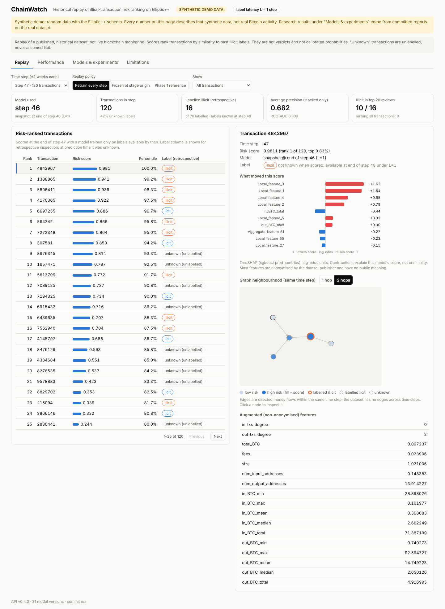
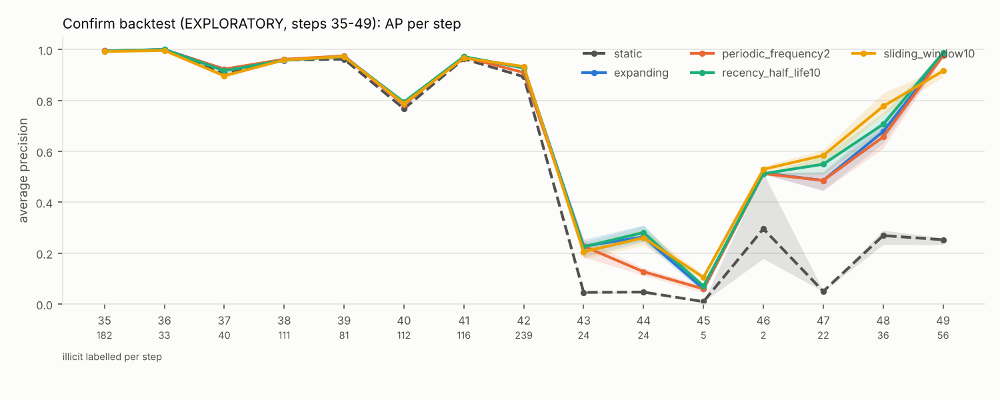
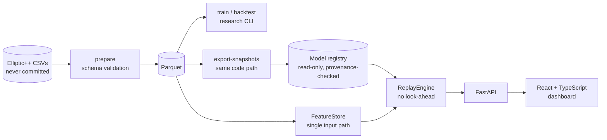
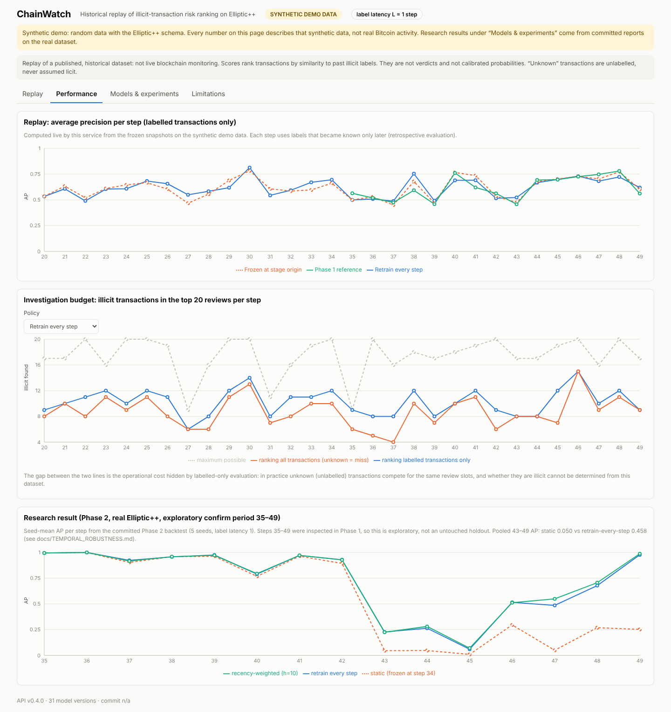
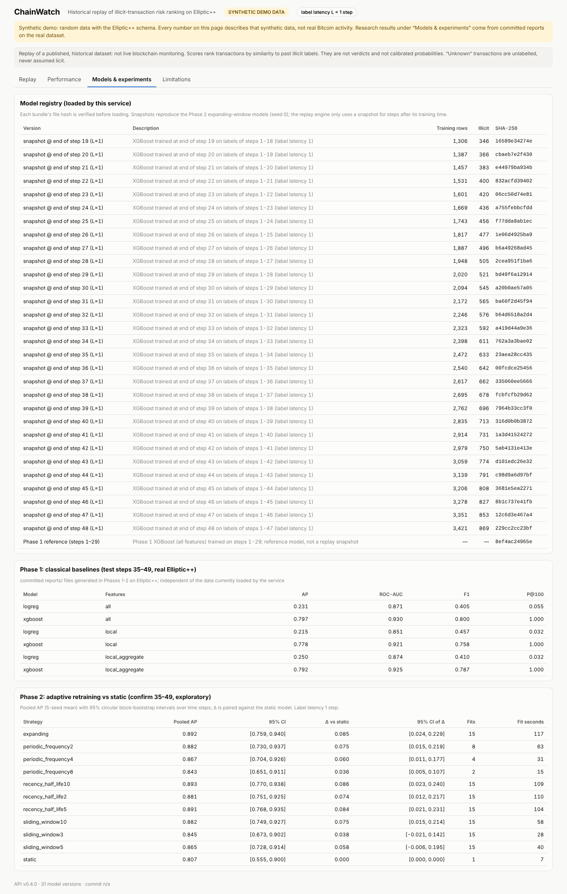

# ChainWatch

[](https://github.com/Apostal322/ChainWatch/actions/workflows/ci.yml)
[](LICENSE)


**How well does an illicit-transaction ranking model hold up when behaviour changes over
time, and does retraining on newly arriving labels help?**

ChainWatch answers this on the public [Elliptic++](https://github.com/git-disl/EllipticPlusPlus)
Bitcoin dataset (203,769 transactions, 49 time steps, 77% unlabelled) with a
leakage-guarded temporal study whose protocol was fixed before the runs (author's record;
not verifiable from the published git history). It then serves the frozen research models
through a FastAPI and React replay application that reproduces the research scores exactly.

> **Scope.** The research and its replay are *historical*. Scores rank transactions by
> similarity to past *labelled* illicit activity; they are not calibrated probabilities,
> evidence of crime, or validated for current transactions. A separate, opt-in
> [live monitor](docs/LIVE_MONITOR.md) observes real mempool data and applies **no** model.


<sub>Replay dashboard running the synthetic demo (every screenshot in this repository uses
synthetic data; real-data results appear only as aggregate figures under `reports/`).</sub>

## Key results (real Elliptic++)

| Finding | Result | Evidence status |
|---|---|---|
| Strong baseline hides a collapse | XGBoost pooled test AP **0.797**, but **0.917** on steps 35–42 vs **0.043** on 43–49 | one-time test evaluation |
| Ranking itself degrades, not just the base rate | same XGBoost model: ROC-AUC 0.97 → 0.69 after step 42 | diagnostic |
| Retraining as labels arrive (protocol's primary comparison: pooled AP, steps 35–49) | expanding vs static: AP 0.807 → 0.892, Δ **+0.085** [95% CI 0.024, 0.229] | **exploratory**: period seen before |
| …concentrated after the shift (sub-period 43–49; its boundary came from Phase 1 inspection) | AP 0.050 → 0.458 (+0.41 [0.16, 0.62]); expanding beats static at all 7 late steps (exact one-sided sign test p = 1/128) | **exploratory**; the CI comes from a block bootstrap over only 7 steps (few distinct resamples), so its coverage is likely below 95% |
| Slower labels shrink the gain | label latency 3: Δ AP +0.065 [0.013, 0.173] | exploratory sensitivity |
| Unlabelled transactions crowd the review budget | known illicit in top 20 per step ≈ 0 on 43–49 when unknowns compete | exploratory |

All metrics are computed on *labelled* transactions. No untouched holdout remains after
Phase 1, and the shift's cause cannot be identified from this data: the evidence is
consistent with concept or class-conditional shift. Negative results are reported in full
in [the temporal robustness report](docs/TEMPORAL_ROBUSTNESS.md).



## What the project demonstrates

| Skill | Where to look |
|---|---|
| **Leakage-safe, reproducible experiments**: chronological splits, label-latency canaries, configs, seeds and data hashes recorded per run | [evaluation protocol](docs/EVALUATION.md), `tests/test_splits_and_leakage.py` |
| **Distribution-shift analysis**: prior vs covariate vs class-conditional shift, within-period learnability, calibration | [temporal robustness §3](docs/TEMPORAL_ROBUSTNESS.md) |
| **Adaptive retraining under delayed labels**: rolling-origin backtest, 5 strategies, block bootstrap over time | [protocol](docs/PHASE2_PROTOCOL.md) (written before the runs per the author's record; it first appears in git alongside the results, so the timing is not independently verifiable) |
| **Training/serving consistency**: one `FeatureStore`; 234,596 replayed scores equal the research predictions (max diff **0.0**), natively and in Docker | `chainwatch verify-replay`, [report](reports/phase3/replay_consistency.json) |
| **API engineering**: typed FastAPI contract, provenance-checked model registry, TreeSHAP explanations, size limits, rate limiting, security headers | [inference contract](docs/INFERENCE_CONTRACT.md), [architecture](docs/ARCHITECTURE.md) |
| **Docker and CI/CD**: hash-locked dependencies, digest-pinned images, read-only non-root demo; CI on Ubuntu and Windows plus a container smoke test | [`Dockerfile`](Dockerfile), [CI](.github/workflows/ci.yml) |
| **Measured performance**: batch of 822 IDs p50 **38 ms**, single ID 16 ms, explanation 15 ms (real data, 4 vCPU) | [benchmark](reports/phase3/benchmark_ellipticpp.json) |
| **Engineering judgement**: an audit and a release review found 18 issues (1 high, 5 medium); each fix is tested or verified | [audit](docs/AUDIT.md) |

## Architecture



Step *s* is scored by a snapshot trained at the end of step *s−1* on labels available by
then (label latency L = 1). Details: [docs/ARCHITECTURE.md](docs/ARCHITECTURE.md).

## Try it

**Synthetic demo (no dataset needed):**

```bash
docker compose --profile demo up --build     # first build ≈ 5 min; then open http://localhost:8000
```

The demo trains real models on synthetic data with the Elliptic++ schema and shows a
permanent "SYNTHETIC DEMO DATA" banner. **There is no hosted demo yet**;
[docs/DEPLOYMENT.md](docs/DEPLOYMENT.md) has measured free-tier fit and step-by-step guides.

| Performance view | Models & experiments |
|---|---|
|  |  |

**Native install** (Python ≥ 3.11, Node 22):

```bash
python -m venv .venv && source .venv/bin/activate     # Windows: .venv\Scripts\Activate.ps1
pip install -e ".[dev]"
(cd frontend && npm ci && npm run build)
chainwatch --config configs/demo.yaml demo-setup      # synthetic data -> models -> registry
chainwatch --config configs/demo.yaml serve           # http://127.0.0.1:8000
```

**Reproduce the research** (downloads about 700 MB from the dataset authors):

```bash
chainwatch download && chainwatch prepare
for fs in local local_aggregate all; do chainwatch --feature-set $fs train --model all; done
for d in artifacts/runs/*/; do chainwatch evaluate --run-dir "$d"; done && chainwatch report --latest
chainwatch backtest --stage dev && chainwatch backtest --stage confirm && chainwatch backtest-report   # ≈ 3 h
chainwatch export-snapshots && chainwatch verify-replay && chainwatch serve
```

Research numbers are guaranteed for the recorded library versions (scikit-learn 1.9.1,
xgboost 3.4.1, Python 3.13); every artifact records its config, seed, data hashes and
git commit.

## Live Bitcoin monitor (Phase 5, local and opt-in)

A zero-cost asynchronous pipeline:
1. the mempool.space WebSocket (`track-mempool-txids`) announces new txids;
2. they are validated and deduplicated, and a 5% hash sample is taken;
3. details are fetched over REST, rate-limited (30 requests/min, pauses on HTTP 429) with
   bounded queues;
4. observation-time features and **rule-based** indicators are computed;
5. results go to SQLite, then to a read-only FastAPI (`/v1/live/*`, server-sent events)
   and the "Live monitor" tab.

```bash
chainwatch --config configs/live.yaml live-collect     # separate process; talks to mempool.space
chainwatch --config configs/live.yaml serve            # dashboard reads the SQLite file
```

* Live mode is **disabled** in the public demo and in every other config.
* The tab labels real network data separately from synthetic data, and labels any
  non-mempool.space source as a mock.
* Output sums are never treated as payment amounts, and no ownership is inferred.
* Real ingestion has **not** been verified from the build environment (its proxy blocks
  mempool.space). Verification status, measurements and limitations are in
  [docs/LIVE_MONITOR.md](docs/LIVE_MONITOR.md), and a plan for a properly evaluated live
  model in [docs/LIVE_ML_PROPOSAL.md](docs/LIVE_ML_PROPOSAL.md).

### Always-on collector (v0.6.0, prepared, not deployed)

`deploy/oracle/` holds a kit for running the collector on its own on a small Linux VM,
targeting Oracle Cloud Always Free. It contains systemd units, Caddy HTTPS, an
idempotent `install.sh` and `smoke_live.sh`.

* The VM runs only `chainwatch-live`: the collector, a token-protected read-only edge API
  on 127.0.0.1 and daily backups. It has hash-locked dependencies and no ML stack.
* The Render dashboard can proxy that API server-to-server
  (`configs/public-demo-live.yaml`). Browsers never see the token or the database.
* Restarts, disconnections and mempool sequence gaps are recorded as outages, and the
  dashboard shows them together with the observed share of time.

Nothing has been deployed, and no 24/7 reliability is claimed. See
[docs/LIVE_CLOUD.md](docs/LIVE_CLOUD.md) for provider limits, Oracle's idle-reclamation
risk, the manual activation steps and the 24-hour test plan.

## Limitations

- **No untouched holdout.** Steps 35–49 were inspected in Phase 1, so the retraining gains
  are exploratory. The label latency is an assumption.
- **Protocol timing is not verifiable.** The Phase 2 protocol was written before the runs
  according to the author's record, but the pre-release history is not published.
- **Publisher-computed features.** The 72 aggregate features cannot be verified to use
  only within-step, pre-step-end information ([dataset card](docs/DATASET.md)).
- **Unknown labels.** 77% of transactions are unlabelled and labels are heuristic;
  labelled-only metrics overstate operational value (the dashboard shows the gap).
- **Historical model.** The features are anonymised by the publisher and need each step's
  complete transaction graph, so the model cannot score new transactions.
- **Explanations** are exact TreeSHAP values, but over mostly anonymised features.
- **Trust boundary.** Model artifacts are pickles and must come from your own export; the
  service has no authentication and is meant for a read-only demo.

## Repository layout

```text
src/chainwatch/   data, features, training, evaluation, backtest, analysis, serving (API), live
frontend/         React + TypeScript dashboard
configs/          default.yaml (real data), demo.yaml, public-demo.yaml (hosted demo), live.yaml
tests/            370 tests: leakage canaries, metrics, backtest causality, API contract
reports/          committed aggregate results and figures (no row-level data)
docs/             case study, protocols, results, inference contract, deployment, audit
deploy/oracle/     always-on collector: systemd units, Caddy, install and smoke scripts
scripts/          screenshot capture, demo smoke test, mock mempool, live load test
```

## Documentation

| Read this | For |
|---|---|
| [Case study](docs/CASE_STUDY.md) | the whole project in one narrative |
| [Temporal robustness](docs/TEMPORAL_ROBUSTNESS.md) · [protocol](docs/PHASE2_PROTOCOL.md) | Phase 2 research, CIs and negative results |
| [Results](docs/RESULTS.md) · [evaluation](docs/EVALUATION.md) · [dataset card](docs/DATASET.md) | Phase 1 baselines, metrics, data provenance and licensing |
| [Inference contract](docs/INFERENCE_CONTRACT.md) · [architecture](docs/ARCHITECTURE.md) | what the service may claim and how it is built |
| [Deployment](docs/DEPLOYMENT.md) · [audit](docs/AUDIT.md) · [release readiness](docs/RELEASE_READINESS.md) · [changelog](CHANGELOG.md) | hosting, security review, release checklist, release notes |
| [Live monitor](docs/LIVE_MONITOR.md) · [always-on cloud kit](docs/LIVE_CLOUD.md) · [live ML proposal](docs/LIVE_ML_PROPOSAL.md) | Phase 5 data pipeline, API contract, limits, measurements; 24/7 deployment plan |
| [Interview guide](docs/INTERVIEW_GUIDE.md) · [portfolio material](docs/PORTFOLIO.md) | explanations and verified resume bullets |

## Development

```bash
pytest -q && ruff check . && ruff format --check .
cd frontend && npm ci && npm run typecheck && npm test && npm run build
scripts/smoke_demo.sh http://localhost:8000      # end-to-end check of a running public demo
```

**Status.** Completed: data pipeline, Phase 1 baselines, Phase 2 retraining backtest (protocol fixed before the runs, author's record)
and shift diagnostics, replay service and dashboard, Docker, CI, live mempool monitor MVP
(no model), always-on collector deployment kit (not deployed). Planned (not
implemented): a properly evaluated live-data model, pickle-free model format,
label-efficiency study, probability calibration
under prior shift, and a graph-model comparison only after a cheaper graph-feature
baseline. ChainWatch contains no graph neural network.

## Citation and licence

Dataset: Y. Elmougy and L. Liu, *Demystifying Fraudulent Transactions and Illicit Nodes in
the Bitcoin Network for Financial Forensics*, KDD 2023; original Elliptic data: M. Weber et
al., KDD Workshop on Anomaly Detection in Finance, 2019. The dataset is subject to its
authors' terms and is never redistributed here ([dataset card](docs/DATASET.md)).

**Licence.** The ChainWatch source code and documentation are released under the
[MIT License](LICENSE). The MIT License does **not** cover the Elliptic++ dataset, which
remains under its authors' terms; the aggregate statistics and figures under `reports/`
are derived from it and are included for research reproducibility only.
