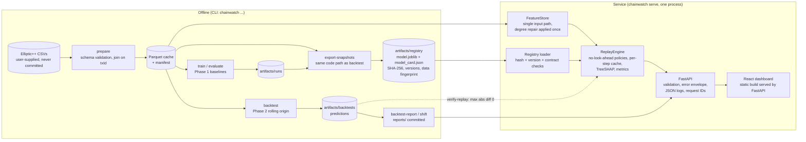
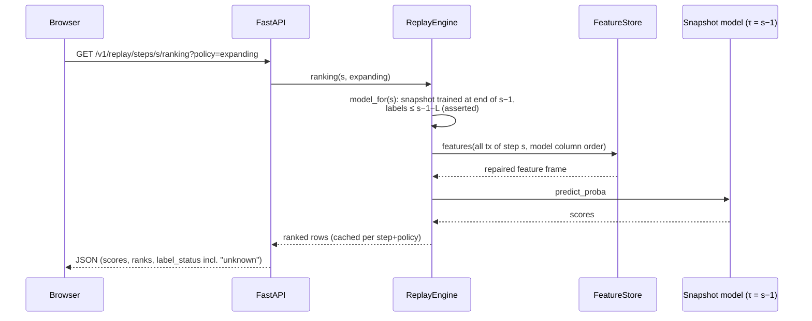

# Architecture

ChainWatch is one Python package (`src/chainwatch`), one React dashboard (`frontend/`) and
one container. Research code (Phases 1–2) and serving code (Phase 3) share the same data
loading, feature and training functions, and the service is tested to reproduce the
research predictions exactly.

## System boundaries

Four parts share one package but never share data:

| Part | Runs where | Data | Models | Entry point |
|---|---|---|---|---|
| Historical ML research (Phases 1–2) | your machine | Elliptic++ CSVs you download (never committed) | trained here; results committed as aggregates in `reports/` | `chainwatch prepare / train / backtest` |
| Synthetic demonstration (Phase 3) | Render (public), Docker | generated synthetic data baked into the image | trained on that synthetic data at image build | `chainwatch serve` with `public-demo.yaml` |
| Local live monitoring (Phase 5) | your machine | real mempool.space observations in a local SQLite file | **none** (rule-based indicators only) | `chainwatch live-collect` + `serve` with `live.yaml` |
| Persistent cloud monitoring (v0.6.0, prepared) | a small VM (Oracle Always Free target) | the same, designed to be collected continuously (not deployed) | **none**; the VM has no ML packages | `chainwatch-live collect / serve-edge` (systemd) |

* The Elliptic++ models are never applied to live transactions: their anonymised features
  cannot be computed for new transactions.
* Live rows never enter the synthetic replay. The two modes have separate routes
  (`/v1/replay/*` vs `/v1/live/*`), storage and dashboard tabs, and every live response
  says where its data came from.
* In remote mode the public dashboard proxies `/v1/live/*` to the VM's edge API server to
  server. It never opens the database or contacts mempool.space, and the browser never
  sees the token. See [LIVE_CLOUD.md](LIVE_CLOUD.md) for the deployment and
  [LIVE_MONITOR.md](LIVE_MONITOR.md) for the pipeline.

Why SQLite for live data: one writer (the collector) and a few readers on one machine;
WAL gives concurrent reads; the whole store is one file to back up; retention keeps it
bounded at about 60 MB. A second collector, or readers on other machines, would need a
server database. That is outside the current scope and documented as a scaling limit.

## Components

## Request flow: replaying one time step

## Design decisions

| Decision | Why | Trade-off |
|---|---|---|
| **Replay over a historical dataset, no live endpoint** | 165 of 182 features are anonymised and standardised by the publisher; aggregate features need the full end-of-step graph. A hash or wallet endpoint would imply a capability the model does not have. | The service is a research and replay system, not a monitoring product. |
| **Snapshots re-exported through the backtest code path** | Phase 2 discarded models after scoring. Reusing `training_plan` and `fit_plan` means the served models are the backtest models (verified: 234,596 scores identical). | About 5 min (4 CPU threads) to build 30 snapshots; 40 MB on disk. |
| **`FeatureStore` as the only input path** | The training-time degree repair lives outside the pickled pipeline. Centralising it removes training/serving skew by construction. | Inputs come from the processed dataset only; there is no ad-hoc feature computation. |
| **Registry = trusted code; read-only at runtime** | Unpickling executes code. The demo registry is built at image-build time as root and served read-only by uid 10001; real registries are mounted read-only. A SHA-256 per bundle catches corruption or mixed exports, but cannot stop someone who can write the directory, which is why write access is removed. Version names are allow-listed and contained in the registry dir. | Pickle remains a trust requirement; a pickle-free format (XGBoost JSON + declarative preprocessing) is future work. |
| **Library-version gate** | Pickled sklearn and xgboost objects are not guaranteed portable. The image pins the training versions (`requirements/serve.lock.txt`). | Upgrading libraries requires re-exporting the registry. |
| **Data fingerprint binding** | The registry records a hash of the processed data; the service refuses to serve models against different data. | Any data change requires re-export. |
| **Scores and ranks, no labels or alerts** | Re-weighted training means uncalibrated outputs, and labels are heuristic. Ranking for a review budget is the defensible use. | Users who want a yes/no flag must choose a threshold themselves. |
| **Unknown never treated as licit** | 77% of transactions are unlabelled. Every transaction-level response carries `label_status`, and budget metrics are shown both labelled-only and over all transactions. | Shows a less flattering operational picture (deliberately). |
| **Exact TreeSHAP via `pred_contribs`** | Explanations come from the model itself (no surrogate), at about 15 ms per request. | Feature names are anonymised; explanations have limited business meaning. |
| **One process, one container, static dashboard** | No microservices: the data fits in memory (about 660 MB RSS), and per-step scoring takes about 12 ms for about 800 rows. | Horizontal scaling would need a shared registry and data volume (straightforward, not needed now). |
| **Synthetic demo mode** | The dataset has no redistribution licence. The demo exercises every code path on schema-identical random data, with a permanent banner. | Demo numbers are meaningless by design. |

## Testing strategy

| Layer | Tests |
|---|---|
| Data, splits, leakage (Phases 1–2) | schema validation, join on id, unknown handling, chronological guards, label-latency canaries (corrupting unavailable labels changes no score) |
| Registry | tampered file rejected, version mismatch rejected (unless allowed), feature contract checked, mismatched data fingerprint refuses to start |
| Inference consistency | replay = backtest predictions (synthetic, in CI) and `chainwatch verify-replay` (real data: 234,596 scores, max abs diff 0.0; Phase 1 reference reproduces AP 0.7969) |
| API | health and readiness, models, ranking order and label mapping, labelled-only metrics, TreeSHAP additivity (contributions + base = logit = logit(score)), neighbourhood within one step, batch partial errors and order, temporal-validity flag, 422/404/413 error envelopes with request IDs, feature-vector validation (missing, extra, null degree, NaN) |
| Frontend | TypeScript strict typecheck, unit tests for formatting (missing values never shown as zero), production build |
| Container | CI builds the image and smoke-tests the synthetic demo container end to end |
