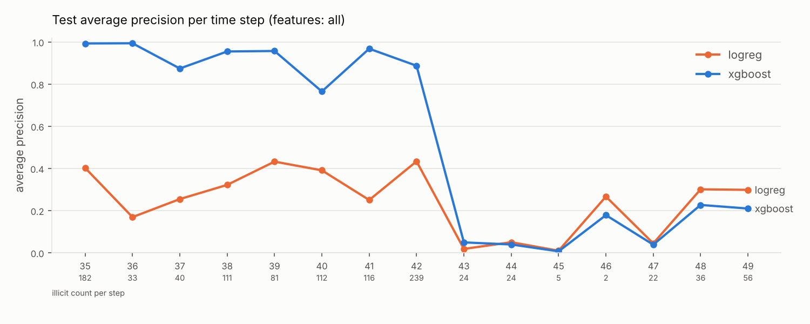

# Phase 1 results: classical baselines

> **Phase 2 update.** `chainwatch audit` independently reproduced every number below.
> Phase 2 also found that the Phase 1 "static" model never used the labels of steps
> 30–34, and that retraining as labels arrive recovers much of the post-step-42 collapse.
> See [TEMPORAL_ROBUSTNESS.md](TEMPORAL_ROBUSTNESS.md).

Numbers are copied from the generated [`reports/baseline_results.md`](../reports/baseline_results.md)
and `reports/baseline_per_time_step.csv`, which `chainwatch report` creates from the
evaluated artifacts. Protocol: [EVALUATION.md](EVALUATION.md). Single seed (42).
Uncertainty intervals have not been computed yet, so treat small differences (under
about 0.01 AP) as noise.

## Pooled test metrics (time steps 35 to 49, prevalence 0.065)

| model | features | AP | ROC-AUC | precision | recall | F1 | P@100 | P@500 | R@500 |
|---|---|---|---|---|---|---|---|---|---|
| LogReg | local (93) | 0.215 | 0.851 | 0.353 | 0.645 | 0.457 | 0.032 | 0.018 | 0.008 |
| LogReg | local+aggregate (165) | 0.250 | 0.875 | 0.289 | 0.705 | 0.410 | 0.032 | 0.034 | 0.016 |
| LogReg | all (182) | 0.231 | 0.871 | 0.278 | 0.742 | 0.405 | 0.055 | 0.028 | 0.013 |
| XGBoost | local (93) | 0.778 | 0.921 | 0.841 | 0.690 | 0.758 | 1.000 | 1.000 | 0.462 |
| XGBoost | local+aggregate (165) | 0.792 | 0.925 | 0.852 | 0.731 | 0.787 | 1.000 | 1.000 | 0.462 |
| XGBoost | all (182) | **0.797** | **0.930** | **0.898** | 0.722 | **0.800** | 1.000 | 1.000 | 0.462 |

(R@500 = 0.462 is the ceiling for K = 500, since 500 / 1,083 = 0.462.)

## Findings

### 1. Gradient-boosted trees dominate linear models
XGBoost reaches 3.2x to 3.6x the AP of logistic regression, depending on the feature set. Its 500
highest-scored test transactions are all labelled illicit.

### 2. Logistic regression fails through extrapolation, not just weak capacity
LR's ROC-AUC (0.85 to 0.87) looks respectable, but the top of its ranking is mostly
licit: P@100 is between 0.03 and 0.06. On validation, LR reached AP 0.77 to 0.82, so the
gap between validation and test is large. The diagnosis:

* the transactions LR ranks highest in the test period come mostly from step 43 and have
  extreme feature values (median of per-row max |z| = 9.5, compared with 3.9 for typical
  training rows);
* with weak regularisation (selected C = 100 to 1000), a linear model's logit grows
  without bound along such directions, so out-of-distribution transactions receive
  saturated scores (110 to 349 test items tie at the maximum probability).

This is an honest negative result, and it was **not** "fixed" by tuning against the
test set. Candidate remedies (clipping or quantile-transforming inputs, stronger
regularisation selected on a later validation window) must be validated without
looking at test data again.

### 3. The pooled numbers hide a collapse after time step 42
For XGBoost with all features:

| test steps | illicit | prevalence | pooled AP | recall at threshold |
|---|---|---|---|---|
| 35 to 42 | 914 | 0.092 | 0.917 | 0.852 |
| 43 to 49 | 169 | 0.025 | **0.043** | **0.018** |

After step 42, every model degrades sharply, though not uniformly to chance. For
XGBoost/all, per-step AP is 0.007–0.049 at steps 43, 44, 45 and 47 (prevalence
0.004–0.026), and 0.18–0.23 at steps 46, 48 and 49 (prevalence 0.003–0.12), against
0.77–0.99 at steps 35–42; per-step ROC-AUC on 43–49 is 0.62–0.94
(`reports/baseline_per_time_step.csv`). The timing coincides with the regime
change that Weber et al. (2019) observed in the original Elliptic data and attributed to
a dark-market shutdown; our data cannot confirm that cause. Better feature sets do not
help, because all six models collapse together. This motivated the Phase 2 question of
whether the obstacle is **distribution shift rather than model capacity**, which Phase 2
investigates (association only, not a causal conclusion).



### 4. Feature-set ablation: small, consistent gains for XGBoost
local → +aggregate → +augmented gives AP 0.778 → 0.792 → 0.797 for XGBoost. The
neighbourhood (aggregate) features help more than the Elliptic++ augmented features.
These gaps come from a single seed with no confidence intervals, so they suggest a
trend but do not establish one.

### 5. Investigation-budget view
With 20 reviews per two-week window, XGBoost/all averages a precision of 0.56 across the
15 test steps. It is 1.0 at every step from 35 to 42 and 0.00–0.25 afterwards (0 at
three of the seven steps: 43, 45 and 47). Mean per-step P@20 for LR/all is 0.08.

### 6. Latency
All models score a transaction in single-digit milliseconds in-process (p50 2 to 6 ms
per single-row call, which is dominated by pandas/sklearn per-call overhead) and in
under 5 µs per transaction in batch. Latency will not be a constraint for these models.
Exact numbers are machine-dependent and listed in the generated report.

## Context: published numbers

The Elliptic++ authors' tutorial notebook reports, for XGBoost on a 1–34 / 35–49 split,
precision 0.793, recall 0.718 and F1 0.754 at threshold 0.5. Those numbers are **not
directly comparable** to ours. That notebook drops rows with missing values, fits
`MinMaxScaler` on all rows including the test set, trains on steps 1 to 34 (we hold out
30 to 34 for validation), and uses default hyper-parameters with no imbalance
weighting. They are listed only to show that our numbers are in a plausible range.

## Reproducing

```bash
for fs in local local_aggregate all; do chainwatch --feature-set $fs train --model all; done
for d in artifacts/runs/*/; do chainwatch evaluate --run-dir "$d"; done
chainwatch report --latest
```

Reproducibility check (XGBoost/all, Linux, 4 CPU threads): an independent retrain with
the same seed reproduced the validation AP and early-stopping iteration of all 12 grid
candidates exactly, and selected the same hyper-parameters and threshold. Results on
other platforms or library versions may differ slightly (floating-point summation order).
