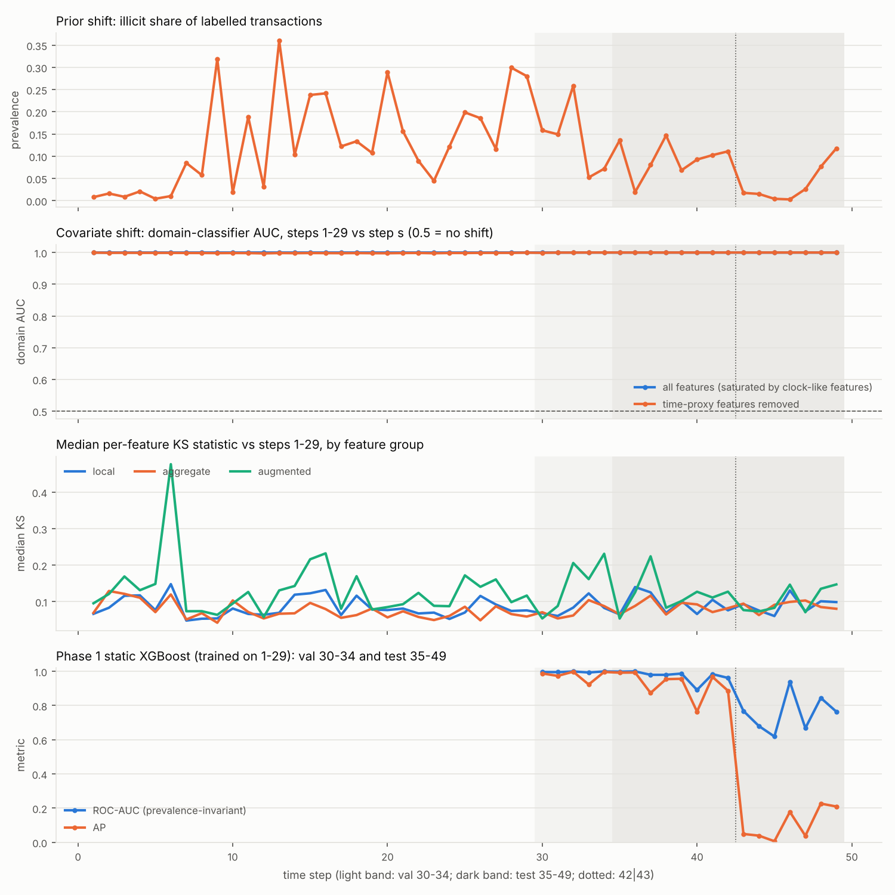
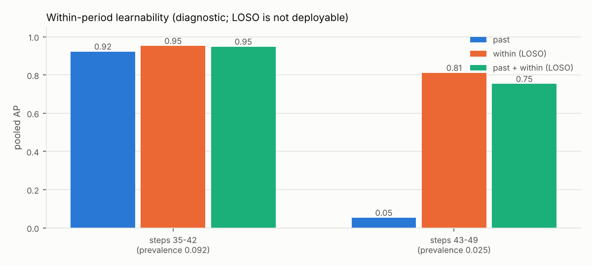
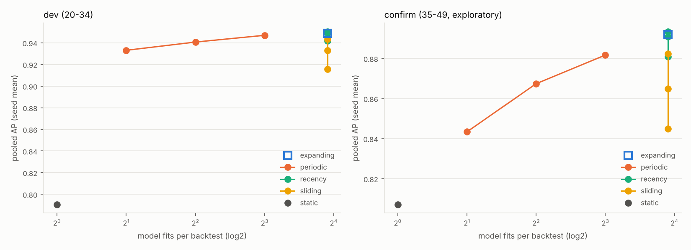

# Phase 2 report: temporal robustness and adaptive retraining

**Question.** Why does illicit-transaction detection deteriorate over time on Elliptic++,
and do adaptive retraining strategies help under distribution shift and fixed
investigation budgets?

**Short answer.** The collapse after step 42 is mainly a **stale-model problem**, not an
unlearnable one. A model fitted on recent labels ranks late-period transactions well,
while the model fitted on the past does not. Retraining as labels arrive raises pooled AP
on steps 43–49 from 0.05 to 0.42–0.49, and the gain is consistent across seeds,
strategies and bootstrap schemes. It shrinks with longer label latency and cannot help
the first steps after the change, before any new labels exist. Steps 35–49 were inspected
in Phase 1, so every number on that period is **exploratory**.

Every number in this report comes from generated files. The main sources are
[`reports/phase2/backtest/README.md`](../reports/phase2/backtest/README.md),
[`reports/phase2/shift/summary.json`](../reports/phase2/shift/summary.json) and
[`reports/phase2/audit.json`](../reports/phase2/audit.json). The pre-registered protocol,
with its list of deviations, is [PHASE2_PROTOCOL.md](PHASE2_PROTOCOL.md).

---

## 1. Audit of Phase 1

`chainwatch audit` re-predicts every Phase 1 run from its saved model and recomputes the
metrics with plain scikit-learn.

* **Verified:** raw-file hashes; split boundaries; test predictions reproduced exactly
  (maximum difference 0.0); AP, ROC-AUC and F1 reproduced exactly; every threshold equals
  the max-F1 point on the saved validation predictions; XGBoost/all AP of 0.917 on steps
  35–42 and 0.043 on steps 43–49.
* **Weaknesses found** (full table in the protocol, §0): the static model never used the
  labels of steps 30–34; label latency was implicitly zero; aggregate and out-degree
  features assume end-of-step batch scoring; one validation window had three jobs;
  there was a single seed and no uncertainty estimate; budget metrics were computed
  among labelled rows only; and the test period has been inspected.
* **New finding: clock-like features.** Aggregate_feature_8, 10, 43, 7 and 46 have
  |Spearman ρ| between 0.95 and 0.997 with the time step on steps 1–34. These five
  features were the most "shifted" in the Phase 1 EDA. In effect they let a model read
  the period, which is the very information Phase 1 excluded by dropping `Time step`.
  §4.3 tests whether this matters. It does not, materially.

## 2. Setup (pre-registered)

* **Prediction-time model.** Each step is scored at its end. A label from step *u* becomes
  available at the end of step *u + L*. **Primary analysis L = 1**; sensitivity L = 3.
  A model retrained at τ uses labels from steps ≤ τ − L only. The schedule code asserts
  this for every fit, and canary tests show that corrupting unavailable labels or future
  features leaves every score bit-for-bit unchanged.
* **Learner.** XGBoost with the Phase 1 hyper-parameters, a fixed 500 trees, all 182
  features, and `scale_pos_weight` computed from the (weighted) training labels.
  Identical for every strategy.
* **Strategies.** Static (one fit at the origin, on all available labels); expanding
  (retrain every step); periodic f ∈ {2, 4, 8}; sliding W ∈ {3, 5, 10} steps; recency
  weighting h ∈ {2, 5, 10} steps. Each family has the same tuning budget.
* **Stages.** *Dev*: origin 19, scored steps 20–34, 3 seeds. Selection happens here only.
  *Confirm*: origin 34, scored steps 35–49, 5 seeds, exploratory. Confirm refuses to run
  without the frozen dev selection.
* **Uncertainty.** Paired circular block bootstrap over time steps (block length 3,
  2,000 resamples). Metrics are averaged over training seeds within each replicate.
  Time steps, not transactions, are resampled, because a step is one connected graph
  and one market regime.
* **Primary metrics.** Pooled AP, and illicit transactions found when reviewing the top
  50 labelled transactions per step (tie-aware).

**Dev selection (frozen before confirm ran):** `periodic_frequency2`, `sliding_window10`,
`recency_half_life10`; static and expanding have no parameter. Two selections sit on the
edge of their grid: the largest window, and the longest half-life (which approaches
expanding). The optimum may lie beyond the grid. The grid was not extended afterwards.

## 3. Distribution-shift diagnosis

| aspect | evidence | interpretation |
|---|---|---|
| **Prior shift**, P(y) | Illicit share of labelled transactions: 0.109 (steps 1–29), 0.168 (30–34), 0.092 (35–42), **0.025 (43–49)**; per step it ranges from 0.003 to 0.36 | Large, and it lowers AP mechanically. |
| …but not only prior shift | Static model ROC-AUC (prevalence-invariant): 0.97 on 35–42, **0.70** on 43–49. AP standardised to prevalence 0.109: 0.92 versus **0.17** | Ranking quality itself collapses. |
| **Covariate shift**, P(x) | A step-level domain classifier separates *every* step from steps 1–29 with AUC ≈ 1.0, even with the time proxies removed (per-step minimum 0.997, period means 0.9985–0.99997). Period means of the median per-feature KS against steps 1–29 lie between 0.075 and 0.094 for local and aggregate features in every period, with **no jump at step 43** | Each step is identifiable from its features, so domain AUC cannot measure *how much* shift matters (a negative result for this diagnostic). Bulk marginal shift does not coincide with the collapse. |
| Missingness | Labelled missing-feature rate: 0.6% (1–29), 1.0% (30–34), **2.9% (35–42)**, 1.0% (43–49) | Peaks before the collapse, not during it. Not an explanation. |
| **Class-conditional shift**, P(x\|y) | Per-class domain classifiers are saturated as well (AUC ≥ 0.99) | Uninformative at this resolution. |
| **Signs of concept shift**, P(y\|x) | On 43–49, the past-only model scores AP 0.053 (ROC 0.70). A leave-one-step-out model fitted only on *other late steps* scores **AP 0.811** (ROC 0.98). Past plus late scores 0.753, worse than late alone. On 35–42 all three models are similar (0.92 / 0.95 / 0.95) | Late illicit transactions are **predictable from these features**, but not by the boundary learned from the past, and adding past data slightly hurts. This fits concept shift, or class-conditional shift into regions the training data never covered. The data cannot separate the two, and no causal claim is made. (LOSO uses later steps, so this is diagnostic only.) |
| **Scores** | Median static score of illicit transactions is ≥ 0.994 on every step from 35 to 42, and ≤ 0.008 on steps 43–49 except step 46 (2 illicit) | Late illicit transactions look licit to the old model. |
| **Calibration** (Platt fitted on 30–34) | ECE 0.010 (30–34), 0.018 (35–42), 0.047 (43–49), reaching 0.138 at step 49; mean predicted 0.029 against observed 0.118 at step 49 | Calibration degrades and the model under-predicts late. |
| **Budgets** | Static P@20 per step averages 1.00 on 35–42, and on 43–49 it is between 0.00 and 0.25 (0 at four of seven steps) (see `static_model_by_step.csv`) | The operational failure is total, not just a metric artefact. |

Weber et al. (2019) attribute the regime change after step 43 in the original Elliptic
data to the shutdown of a dark market. Our data are consistent with a change in what
labelled-illicit transactions look like, but they cannot confirm that cause.




## 4. Static versus adaptive retraining

### 4.1 Main comparison (L = 1; Δ = strategy − static, 95% block-bootstrap CI)

| strategy | dev 20–34: pooled AP | Δ AP (dev) | confirm 35–49: pooled AP | Δ AP (confirm) | confirm 43–49: pooled AP | Δ AP (43–49) |
|---|---|---|---|---|---|---|
| static | 0.791 | — | 0.807 | — | 0.050 | — |
| expanding | 0.949 | +0.158 [0.018, 0.270] | 0.892 | +0.085 [0.024, 0.229] | 0.458 | +0.407 [0.156, 0.622] |
| periodic f = 2 | 0.947 | +0.156 [0.016, 0.268] | 0.882 | +0.075 [0.015, 0.219] | 0.418 | +0.368 [0.077, 0.606] |
| sliding W = 10 | 0.943 | +0.153 [0.005, 0.268] | 0.882 | +0.075 [0.015, 0.214] | 0.387 | +0.337 [0.160, 0.567] |
| recency h = 10 | 0.950 | +0.160 [0.022, 0.269] | 0.893 | +0.086 [0.023, 0.240] | 0.493 | +0.443 [0.177, 0.652] |

Seed standard deviation of pooled AP is ≤ 0.003 on dev and confirm overall, and ≤ 0.026
on 43–49. Training stochasticity is negligible next to temporal uncertainty.

On steps 35–42 the gains are small: +0.008 to +0.016 AP, with the CIs of expanding,
recency h = 10 and sliding W = 10 touching 0.

### 4.2 Investigation budgets (confirm 43–49; seed means)

Illicit transactions found per budget of K reviews per step, ranking **labelled**
transactions:

| strategy | K = 10 | K = 20 | K = 50 | K = 100 |
|---|---|---|---|---|
| static | 5.2 | 9.2 | 22.6 | 70.6 |
| expanding | 33.8 | 60.4 | 118.2 | 145.4 |
| periodic f = 2 | 32.2 | 57.2 | 111.6 | 138.6 |
| sliding W = 10 | 35.0 | 63.4 | 121.6 | 147.4 |
| recency h = 10 | 34.0 | 62.6 | 123.0 | 147.2 |
| maximum possible | 57 | 107 | 163 | 169 |

**Important caveat.** When **all** transactions are ranked, with the unknown class
competing for the same budget and counted as misses, every strategy finds **0–2** known
illicit transactions at K = 10–20 per step in 43–49, and 14–20 at K = 50. The top of the
ranking is dominated by unlabelled transactions. They could be unlabelled illicit
activity or false positives; the dataset cannot tell. Labelled-only budget metrics
therefore overstate deployable value.

On 35–42, all strategies find 366–368 of 373 possible at K = 50: a ceiling, with no room
to differ.

### 4.3 Pre-registered robustness verdicts (protocol §5)

| strategy | pooled AP | hits@50 |
|---|---|---|
| expanding | **robust** | not robust |
| periodic f = 2 | **robust** | not robust |
| sliding W = 10 | **robust** | not robust |
| recency h = 10 | **robust** | not robust |

"Robust" means the 95% CI excludes 0 with the same sign in dev and confirm, and both
confirm sub-periods share that sign. For hits@50, the rule fails only because the 35–42
difference is 0.0 to −0.8 at the ceiling described above. That is a ceiling effect, not
a reversal. The rule is reported as pre-registered and was not relaxed.

### 4.4 Sensitivity

* **Step-cluster bootstrap (block length 1)** leaves the conclusions unchanged: for
  example, expanding +0.085 [0.029, 0.206] and recency h = 10 +0.086 [0.029, 0.212] on
  confirm.
* **Label latency L = 3** (selection frozen at L = 1) shrinks the gains. The static model
  falls to 0.793 (it now sees labels only up to step 31); expanding is +0.065 [0.013, 0.173], periodic f = 2 +0.071
  [0.016, 0.191], recency h = 10 +0.059 [0.012, 0.159], and sliding W = 10 +0.048
  [−0.003, 0.160]. **The value of adaptation depends on how quickly labels arrive.**
* **Time-proxy ablation (exploratory).** Removing the five clock-like features changes
  pooled AP by at most ±0.004 overall. On 43–49 it is unchanged for static (0.050) and
  slightly lower for the adaptive strategies (−0.020 to −0.038, every CI including 0 or
  touching it). The clock features neither cause the collapse nor drive the recovery.

### 4.5 Per-period behaviour and failure cases


* **Steps 43–45 remain poor for every strategy** (AP 0.06–0.28). At L = 1 the models
  scoring these steps have at most the labels of steps ≤ 41–43. Retraining helps here
  (0.05 → about 0.25 at steps 43–44) only because it uses labels from 34–41 that static
  lacks. No label-driven method can anticipate a change before it produces labels.
* **Recovery follows label arrival.** At steps 47–49 the adaptive models reach AP
  0.49–0.99, while static stays at 0.05–0.27.
* **Short sliding windows lose information.** W = 3 is not significantly better than
  static on confirm (+0.038 [−0.021, 0.142]) and is worse on 35–42 (−0.011).
* **Update frequency.** Confirm AP rises monotonically with retraining frequency:
  0.807 (static) < 0.843 (f = 8) < 0.867 (f = 4) < 0.882 (f = 2) < 0.892 (f = 1).

### 4.6 Computational cost (seconds per backtest, 4 CPU threads, seed mean)

| strategy | fits | fit seconds, dev | fit seconds, confirm |
|---|---|---|---|
| static | 1 | 5 | 7 |
| periodic f = 8 / 4 / 2 | 2 / 4 / 8 | 12 / 24 / 49 | 15 / 31 / 63 |
| sliding W = 10 | 15 | 51 | 58 |
| expanding | 15 | 92 | 117 |
| recency h = 10 | 15 | 84 | 109 |

Prediction costs under 0.6 s per backtest. Even retraining every step costs about 8 s
per retrain on about 37k rows, which is negligible at a two-week cadence. Cost is not a
reason to stay static.



## 5. Negative and null results

1. **Covariate-shift detection by domain classifier failed as a diagnostic.** Every time
   step is identifiable from its features, with or without the time proxies, so it
   cannot rank how much the shift matters. KS statistics show no change in bulk
   marginal shift at the collapse. A drift detector built on feature marginals would
   probably not have warned about step 43.
2. **Removing time-proxy features did not help**, and slightly hurt the adaptive models
   late.
3. **No strategy improves meaningfully over static on 35–42**, where the static model is
   already near its ceiling.
4. **Recency weighting is not reliably better than plain expanding retraining.** The
   point estimates differ by 0.001 overall and 0.035 on 43–49, and their intervals
   overlap heavily. No paired recency-versus-expanding test was pre-registered, so no
   difference is claimed. Short half-lives (h = 2) had lower pooled AP than expanding in every
   period.
5. **The budget-metric gains are not robust** under the pre-registered rule (a ceiling
   effect), and they mostly disappear when unlabelled transactions compete for review
   slots.
6. **Calibration** was diagnosed, not fixed. Recalibration under prior shift is open.

## 6. Limitations

* **No untouched holdout remains.** Steps 35–49 were inspected in Phase 1, and the
  confirm results are exploratory. The dev backtest is honest for selection, but the
  Phase 1 XGBoost hyper-parameters were tuned on steps 30–34, inside dev.
* **15 scored steps per stage and one major regime change.** CIs are wide, and the
  conclusions rest heavily on steps 43–49, which hold only 169 illicit transactions
  (2 at step 46).
* **Label latency is assumed, not known.** Elliptic labels were assigned retrospectively.
  The benefit shrinks between L = 1 and L = 3 and would shrink further with realistic
  investigation delays.
* **The labelled subset is not random**, and "unknown" transactions dominate rankings
  over all transactions. Detection numbers are about *labelled* illicit transactions.
* **End-of-step batch scoring is assumed** (aggregate and out-degree features).
* **Single learner** (XGBoost) and a fixed tree count; strategy parameters at the edge
  of their grid were not extended.
* The time-proxy ablation was added after the main runs (protocol deviation 1).

## 7. Does the evidence justify GraphSAGE or a temporal GNN now?

**A temporal GNN: no.** The transaction graph has **no edges between time steps**, so
message passing cannot carry information across time. A "temporal GNN" here would reduce
to per-snapshot GNNs plus a retraining schedule, and Phase 2 already shows that the
schedule, not the architecture, drives the temporal gains.

**GraphSAGE: only as a tightly controlled experiment, not as the expected fix.**

* The within-period learnability result shows that tabular XGBoost on the existing
  features (which already include one-hop neighbourhood aggregates) reaches AP ≈ 0.81
  on the late regime when trained on that regime's labels. Missing graph capacity is
  not the demonstrated bottleneck. Stale labels are.
* The remaining failure is the **cold start right after a regime change** (steps 43–45).
  The open question is whether multi-hop structural representations generalise across
  regimes better than tabular features. That is a testable hypothesis, but this
  evidence does not support it in advance.

**Recommended Phase 3 design, if pursued:** evaluate GraphSAGE inside the *same*
expanding-window, L = 1 backtest and bootstrap. Compare it first against a cheaper
control, XGBoost plus multi-hop graph features (for example two-hop aggregates and
neighbour-score propagation). Pre-register steps 43–45 as the primary target and a new
holdout rule. Alternatives that the evidence supports at least as strongly: label
latency and labelling strategy (active or prioritised labelling to shorten effective L),
and recalibration under prior shift.

## 8. Reproduce

```bash
chainwatch audit                                        # Phase 1 re-verification
chainwatch --mlflow backtest --stage dev                # selection (steps 20-34)
chainwatch --mlflow backtest --stage confirm            # frozen selection, steps 35-49
chainwatch --mlflow backtest --stage confirm --latency 3
chainwatch backtest --stage dev --drop-time-proxies --strategies selected       # exploratory
chainwatch backtest --stage confirm --drop-time-proxies --strategies selected   # exploratory
chainwatch shift                                        # distribution-shift diagnostics
chainwatch backtest-report                              # tables, CIs, verdicts, figures
```

Wall-clock times on 4 CPU threads: dev about 22 min, confirm about 47 min, L = 3 confirm
about 45 min, ablation about 33 min, shift about 10 min, report about 9 min.
