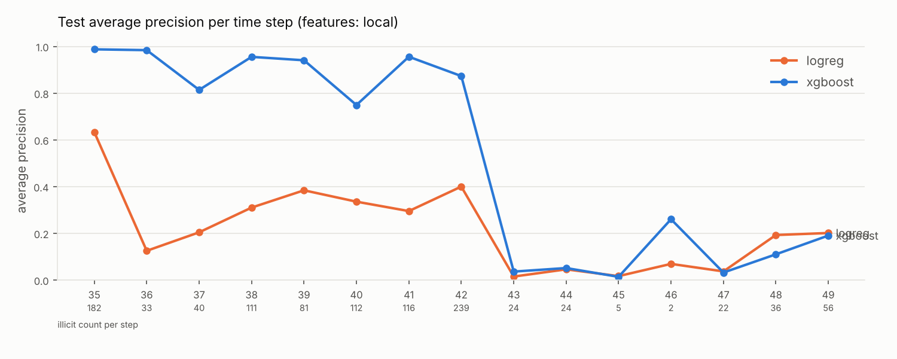
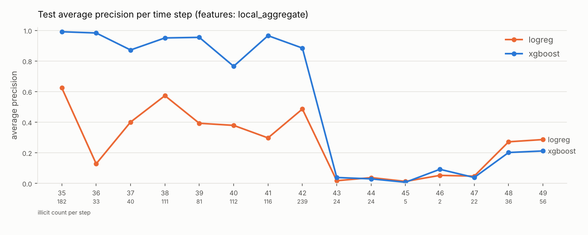

# Phase 1 baseline results (generated)

Generated by `chainwatch report` from `artifacts/runs/*/test_metrics.json`.
Test split = time steps 35-49 (labelled transactions only). Thresholds were chosen
on validation (steps 30-34). See docs/EVALUATION.md for the protocol.

## Pooled test metrics

| model   | features        |   AP (PR-AUC) |   ROC-AUC |   precision |   recall |     F1 |   threshold |   P@100 |   P@500 |   R@500 |
|:--------|:----------------|--------------:|----------:|------------:|---------:|-------:|------------:|--------:|--------:|--------:|
| logreg  | all             |        0.2306 |    0.8711 |      0.2784 |   0.7415 | 0.4048 |      0.9469 |  0.0545 |  0.0280 |  0.0129 |
| xgboost | all             |        0.7969 |    0.9302 |      0.8978 |   0.7221 | 0.8004 |      0.6764 |  1.0000 |  1.0000 |  0.4617 |
| logreg  | local           |        0.2150 |    0.8505 |      0.3532 |   0.6454 | 0.4566 |      0.9701 |  0.0320 |  0.0180 |  0.0083 |
| xgboost | local           |        0.7780 |    0.9208 |      0.8412 |   0.6898 | 0.7580 |      0.7745 |  1.0000 |  1.0000 |  0.4617 |
| logreg  | local_aggregate |        0.2499 |    0.8745 |      0.2890 |   0.7045 | 0.4099 |      0.9737 |  0.0315 |  0.0340 |  0.0157 |
| xgboost | local_aggregate |        0.7919 |    0.9246 |      0.8516 |   0.7313 | 0.7869 |      0.6073 |  1.0000 |  1.0000 |  0.4617 |

## Investigation-budget view (per-step P@20, averaged over test steps)

| model   | features        |   mean per-step P@20 |
|:--------|:----------------|---------------------:|
| logreg  | all             |               0.0800 |
| xgboost | all             |               0.5600 |
| logreg  | local           |               0.0533 |
| xgboost | local           |               0.5433 |
| logreg  | local_aggregate |               0.1133 |
| xgboost | local_aggregate |               0.5533 |

## Per-time-step average precision (test)

|   time_step |   n_illicit |   logreg/all |   logreg/local |   logreg/local_aggregate |   xgboost/all |   xgboost/local |   xgboost/local_aggregate |
|------------:|------------:|-------------:|---------------:|-------------------------:|--------------:|----------------:|--------------------------:|
|          35 |         182 |        0.402 |          0.633 |                    0.624 |         0.992 |           0.987 |                     0.991 |
|          36 |          33 |        0.169 |          0.125 |                    0.128 |         0.993 |           0.984 |                     0.983 |
|          37 |          40 |        0.254 |          0.204 |                    0.400 |         0.874 |           0.814 |                     0.872 |
|          38 |         111 |        0.322 |          0.310 |                    0.573 |         0.954 |           0.955 |                     0.950 |
|          39 |          81 |        0.432 |          0.384 |                    0.393 |         0.957 |           0.940 |                     0.954 |
|          40 |         112 |        0.391 |          0.335 |                    0.379 |         0.765 |           0.749 |                     0.765 |
|          41 |         116 |        0.250 |          0.295 |                    0.297 |         0.967 |           0.956 |                     0.965 |
|          42 |         239 |        0.433 |          0.400 |                    0.486 |         0.887 |           0.873 |                     0.884 |
|          43 |          24 |        0.018 |          0.015 |                    0.017 |         0.049 |           0.036 |                     0.038 |
|          44 |          24 |        0.050 |          0.046 |                    0.037 |         0.039 |           0.051 |                     0.029 |
|          45 |           5 |        0.010 |          0.017 |                    0.012 |         0.007 |           0.014 |                     0.007 |
|          46 |           2 |        0.266 |          0.069 |                    0.052 |         0.178 |           0.260 |                     0.092 |
|          47 |          22 |        0.044 |          0.037 |                    0.047 |         0.038 |           0.032 |                     0.038 |
|          48 |          36 |        0.301 |          0.193 |                    0.271 |         0.227 |           0.110 |                     0.201 |
|          49 |          56 |        0.298 |          0.201 |                    0.286 |         0.210 |           0.190 |                     0.211 |

## In-process inference latency

CPU, single process, model + preprocessing only; for relative comparison.

| model   | features        |   latency p50 (ms/row) |   batch (us/tx) |
|:--------|:----------------|-----------------------:|----------------:|
| logreg  | all             |                 5.5343 |          2.2394 |
| xgboost | all             |                 5.9735 |          4.1442 |
| logreg  | local           |                 2.1373 |          0.4323 |
| xgboost | local           |                 2.8679 |          1.5290 |
| logreg  | local_aggregate |                 2.3797 |          0.7384 |
| xgboost | local_aggregate |                 2.8866 |          4.4336 |
