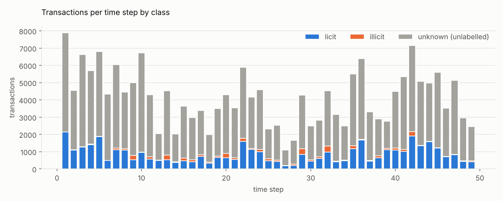
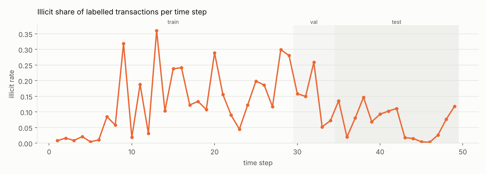
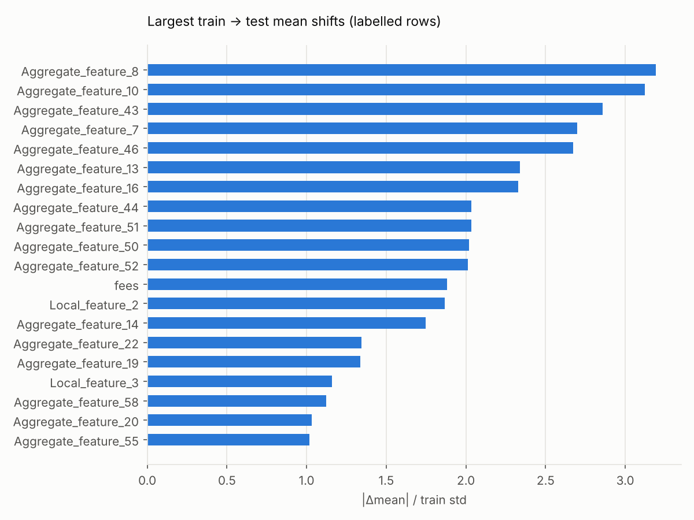

# Elliptic++ transactions: EDA summary

Generated by `chainwatch eda` from the processed dataset. Do not edit by hand.

- Transactions: **203,769**, directed edges: **234,355**, time steps: **49**
- Class counts: {'unknown': 157205, 'licit': 42019, 'illicit': 4545}
- Illicit share among labelled: **0.0976**
- Labelled split sizes: {'train': {'n_labeled': 26381, 'n_illicit': 2871}, 'val': {'n_labeled': 3513, 'n_illicit': 591}, 'test': {'n_labeled': 16670, 'n_illicit': 1083}}
- Rows with missing augmented features: 965 (by class: {'licit': 519, 'unknown': 446})
- Exact duplicate feature rows: 32 (groups with conflicting labels: 0)
- Isolated transactions (no edges): 0; mean degree 2.300
- Mean standardised train->test shift by feature group: {'aggregate': 0.575, 'augmented': 0.245, 'local': 0.195}

## Per time step

|   time_step |   illicit |     licit |   unknown |   labeled |   illicit_rate_labeled |   labeled_fraction |
|------------:|----------:|----------:|----------:|----------:|-----------------------:|-------------------:|
|           1 |   17.0000 | 2130.0000 | 5733.0000 | 2147.0000 |                 0.0079 |             0.2725 |
|           2 |   18.0000 | 1099.0000 | 3427.0000 | 1117.0000 |                 0.0161 |             0.2458 |
|           3 |   11.0000 | 1268.0000 | 5342.0000 | 1279.0000 |                 0.0086 |             0.1932 |
|           4 |   30.0000 | 1410.0000 | 4253.0000 | 1440.0000 |                 0.0208 |             0.2529 |
|           5 |    8.0000 | 1874.0000 | 4921.0000 | 1882.0000 |                 0.0043 |             0.2766 |
|           6 |    5.0000 |  480.0000 | 3843.0000 |  485.0000 |                 0.0103 |             0.1121 |
|           7 |  102.0000 | 1101.0000 | 4845.0000 | 1203.0000 |                 0.0848 |             0.1989 |
|           8 |   67.0000 | 1098.0000 | 3292.0000 | 1165.0000 |                 0.0575 |             0.2614 |
|           9 |  248.0000 |  530.0000 | 4218.0000 |  778.0000 |                 0.3188 |             0.1557 |
|          10 |   18.0000 |  954.0000 | 5755.0000 |  972.0000 |                 0.0185 |             0.1445 |
|          11 |  131.0000 |  565.0000 | 3600.0000 |  696.0000 |                 0.1882 |             0.1620 |
|          12 |   16.0000 |  490.0000 | 1541.0000 |  506.0000 |                 0.0316 |             0.2472 |
|          13 |  291.0000 |  518.0000 | 3719.0000 |  809.0000 |                 0.3597 |             0.1787 |
|          14 |   43.0000 |  374.0000 | 1605.0000 |  417.0000 |                 0.1031 |             0.2062 |
|          15 |  147.0000 |  471.0000 | 3021.0000 |  618.0000 |                 0.2379 |             0.1698 |
|          16 |  128.0000 |  402.0000 | 2445.0000 |  530.0000 |                 0.2415 |             0.1782 |
|          17 |   99.0000 |  712.0000 | 2574.0000 |  811.0000 |                 0.1221 |             0.2396 |
|          18 |   52.0000 |  337.0000 | 1587.0000 |  389.0000 |                 0.1337 |             0.1969 |
|          19 |   80.0000 |  665.0000 | 2761.0000 |  745.0000 |                 0.1074 |             0.2125 |
|          20 |  260.0000 |  640.0000 | 3391.0000 |  900.0000 |                 0.2889 |             0.2097 |
|          21 |  100.0000 |  541.0000 | 2896.0000 |  641.0000 |                 0.1560 |             0.1812 |
|          22 |  158.0000 | 1605.0000 | 4131.0000 | 1763.0000 |                 0.0896 |             0.2991 |
|          23 |   53.0000 | 1134.0000 | 2978.0000 | 1187.0000 |                 0.0447 |             0.2850 |
|          24 |  137.0000 |  989.0000 | 3466.0000 | 1126.0000 |                 0.1217 |             0.2452 |
|          25 |  118.0000 |  476.0000 | 1720.0000 |  594.0000 |                 0.1987 |             0.2567 |
|          26 |   96.0000 |  421.0000 | 2006.0000 |  517.0000 |                 0.1857 |             0.2049 |
|          27 |   24.0000 |  182.0000 |  883.0000 |  206.0000 |                 0.1165 |             0.1892 |
|          28 |   85.0000 |  199.0000 | 1369.0000 |  284.0000 |                 0.2993 |             0.1718 |
|          29 |  329.0000 |  845.0000 | 3101.0000 | 1174.0000 |                 0.2802 |             0.2746 |
|          30 |   83.0000 |  441.0000 | 1959.0000 |  524.0000 |                 0.1584 |             0.2110 |
|          31 |  106.0000 |  604.0000 | 2106.0000 |  710.0000 |                 0.1493 |             0.2521 |
|          32 |  342.0000 |  981.0000 | 3202.0000 | 1323.0000 |                 0.2585 |             0.2924 |
|          33 |   23.0000 |  418.0000 | 2710.0000 |  441.0000 |                 0.0522 |             0.1400 |
|          34 |   37.0000 |  478.0000 | 1971.0000 |  515.0000 |                 0.0718 |             0.2072 |
|          35 |  182.0000 | 1159.0000 | 4166.0000 | 1341.0000 |                 0.1357 |             0.2435 |
|          36 |   33.0000 | 1675.0000 | 4685.0000 | 1708.0000 |                 0.0193 |             0.2672 |
|          37 |   40.0000 |  458.0000 | 2808.0000 |  498.0000 |                 0.0803 |             0.1506 |
|          38 |  111.0000 |  645.0000 | 2135.0000 |  756.0000 |                 0.1468 |             0.2615 |
|          39 |   81.0000 | 1102.0000 | 1577.0000 | 1183.0000 |                 0.0685 |             0.4286 |
|          40 |  112.0000 | 1099.0000 | 3270.0000 | 1211.0000 |                 0.0925 |             0.2703 |
|          41 |  116.0000 | 1016.0000 | 4210.0000 | 1132.0000 |                 0.1025 |             0.2119 |
|          42 |  239.0000 | 1915.0000 | 4986.0000 | 2154.0000 |                 0.1110 |             0.3017 |
|          43 |   24.0000 | 1346.0000 | 3693.0000 | 1370.0000 |                 0.0175 |             0.2706 |
|          44 |   24.0000 | 1567.0000 | 3384.0000 | 1591.0000 |                 0.0151 |             0.3198 |
|          45 |    5.0000 | 1216.0000 | 4377.0000 | 1221.0000 |                 0.0041 |             0.2181 |
|          46 |    2.0000 |  710.0000 | 2807.0000 |  712.0000 |                 0.0028 |             0.2023 |
|          47 |   22.0000 |  824.0000 | 4275.0000 |  846.0000 |                 0.0260 |             0.1652 |
|          48 |   36.0000 |  435.0000 | 2483.0000 |  471.0000 |                 0.0764 |             0.1594 |
|          49 |   56.0000 |  420.0000 | 1978.0000 |  476.0000 |                 0.1176 |             0.1940 |
