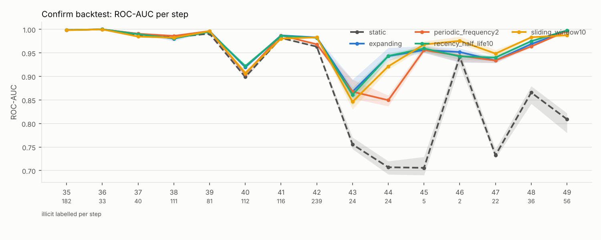
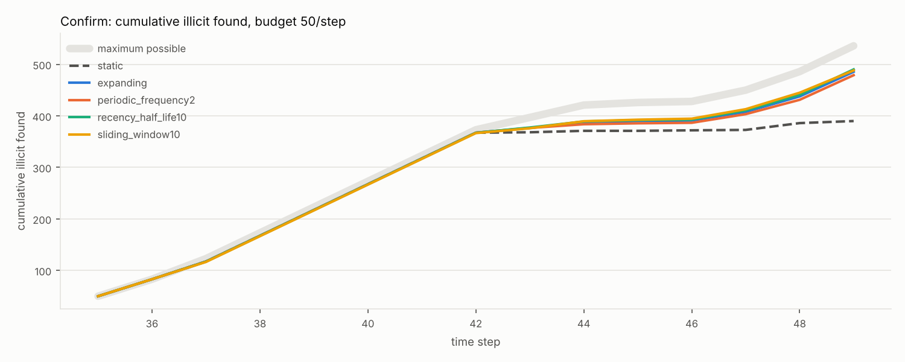
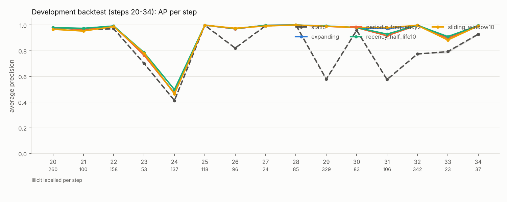
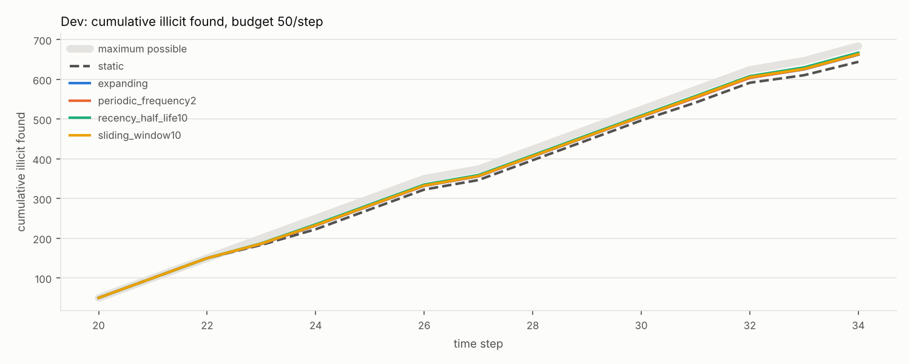
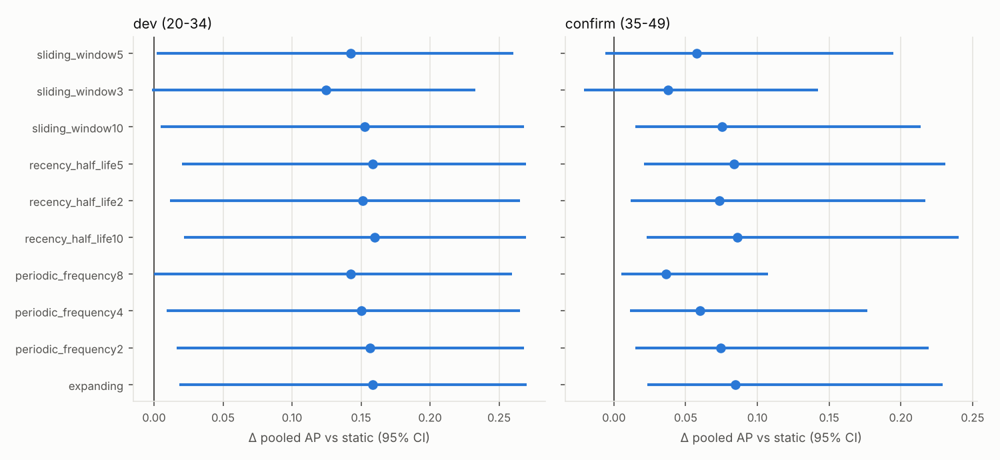
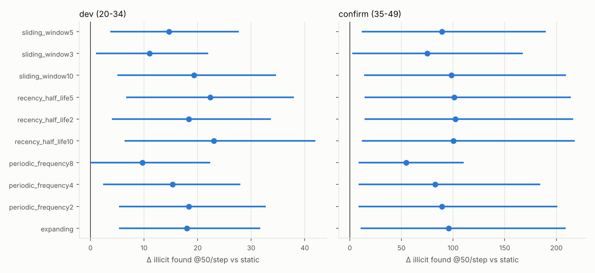

# Phase 2 backtest results (generated)

Generated by `chainwatch backtest-report` from `dev_L1_20261012-213405` (dev) and `confirm_L1_20261012-222153` (confirm). Primary label latency L = 1. Protocol: docs/PHASE2_PROTOCOL.md.

> **The confirm period (35-49) was inspected in Phase 1. Confirm results are exploratory, not an untouched holdout.**

Selected on dev (frozen before confirm ran): `{'expanding': 'expanding', 'periodic': 'periodic_frequency2', 'recency': 'recency_half_life10', 'sliding': 'sliding_window10', 'static': 'static'}`

CIs: paired circular block bootstrap over time steps (block 3, 2000 resamples); metrics averaged over training seeds inside each replicate. `hits@K` = expected illicit transactions found reviewing the top 50 labelled transactions per step (tie-aware), summed over steps; `hits_all` ranks all transactions and counts unknown ones as misses (a lower bound). `std. AP` = AP standardised to prevalence 0.109.

## Development backtest (steps 20-34, seeds [0, 1, 2])

| strategy            | selected   | pooled AP (seed mean±sd)   | pooled AP 95% CI   | ΔAP vs static [95% CI]   | hits@50/step (sum)   | Δhits@50 [95% CI]   |   ROC-AUC |   std. AP |   mean step AP |   hits_all@50 |   fits |   fit s |
|:--------------------|:-----------|:---------------------------|:-------------------|:-------------------------|:---------------------|:--------------------|----------:|----------:|---------------:|--------------:|-------:|--------:|
| static              | yes        | 0.791 ± 0.002              | [0.693, 0.918]     | 0.000 [0.000, 0.000]     | 644.3 / 684          | 0.0 [0.0, 0.0]      |     0.837 |     0.765 |          0.83  |         407.3 |      1 |       5 |
| expanding           | yes        | 0.949 ± 0.000              | [0.866, 0.991]     | 0.158 [0.018, 0.270]     | 662.3 / 684          | 18.0 [5.3, 31.7]    |     0.96  |     0.94  |          0.933 |         453.3 |     15 |      92 |
| periodic_frequency2 | yes        | 0.947 ± 0.001              | [0.865, 0.989]     | 0.156 [0.016, 0.268]     | 662.7 / 684          | 18.3 [5.3, 32.7]    |     0.96  |     0.937 |          0.927 |         441.5 |      8 |      49 |
| periodic_frequency4 |            | 0.941 ± 0.001              | [0.856, 0.985]     | 0.150 [0.009, 0.265]     | 659.7 / 684          | 15.3 [2.3, 28.0]    |     0.958 |     0.93  |          0.915 |         438.3 |      4 |      24 |
| periodic_frequency8 |            | 0.933 ± 0.001              | [0.839, 0.983]     | 0.142 [0.000, 0.260]     | 654.0 / 684          | 9.7 [0.0, 22.3]     |     0.956 |     0.92  |          0.909 |         411.3 |      2 |      12 |
| recency_half_life10 | yes        | 0.950 ± 0.001              | [0.873, 0.990]     | 0.160 [0.022, 0.269]     | 667.3 / 684          | 23.0 [6.3, 42.0]    |     0.968 |     0.941 |          0.933 |         467.5 |     15 |      84 |
| recency_half_life2  |            | 0.942 ± 0.001              | [0.858, 0.986]     | 0.151 [0.012, 0.265]     | 662.7 / 684          | 18.3 [4.0, 33.7]    |     0.956 |     0.931 |          0.925 |         501.8 |     15 |      70 |
| recency_half_life5  |            | 0.949 ± 0.000              | [0.870, 0.990]     | 0.158 [0.020, 0.270]     | 666.7 / 684          | 22.3 [6.7, 38.0]    |     0.966 |     0.94  |          0.933 |         473.7 |     15 |      81 |
| sliding_window10    | yes        | 0.943 ± 0.000              | [0.859, 0.990]     | 0.153 [0.005, 0.268]     | 663.7 / 684          | 19.3 [5.0, 34.7]    |     0.957 |     0.934 |          0.929 |         500.7 |     15 |      51 |
| sliding_window3     |            | 0.915 ± 0.003              | [0.834, 0.965]     | 0.125 [-0.002, 0.233]    | 655.3 / 684          | 11.0 [1.0, 22.0]    |     0.944 |     0.896 |          0.902 |         507.3 |     15 |      25 |
| sliding_window5     |            | 0.933 ± 0.000              | [0.850, 0.982]     | 0.142 [0.002, 0.260]     | 659.0 / 684          | 14.7 [3.7, 27.7]    |     0.951 |     0.92  |          0.918 |         527.2 |     15 |      34 |

## Confirm backtest (steps 35-49, seeds [0, 1, 2, 3, 4], EXPLORATORY)

| strategy            | selected   | pooled AP (seed mean±sd)   | pooled AP 95% CI   | ΔAP vs static [95% CI]   | hits@50/step (sum)   | Δhits@50 [95% CI]   |   ROC-AUC |   std. AP |   mean step AP |   hits_all@50 |   fits |   fit s |
|:--------------------|:-----------|:---------------------------|:-------------------|:-------------------------|:---------------------|:--------------------|----------:|----------:|---------------:|--------------:|-------:|--------:|
| static              | yes        | 0.807 ± 0.002              | [0.555, 0.900]     | 0.000 [0.000, 0.000]     | 390.0 / 536          | 0.0 [0.0, 0.0]      |     0.938 |     0.836 |          0.561 |         258.8 |      1 |       7 |
| expanding           | yes        | 0.892 ± 0.001              | [0.759, 0.940]     | 0.085 [0.024, 0.229]     | 485.6 / 536          | 95.6 [10.6, 208.9]  |     0.976 |     0.917 |          0.716 |         280.1 |     15 |     117 |
| periodic_frequency2 | yes        | 0.882 ± 0.002              | [0.730, 0.937]     | 0.075 [0.015, 0.219]     | 479.0 / 536          | 89.0 [8.4, 201.1]   |     0.97  |     0.907 |          0.704 |         277.6 |      8 |      63 |
| periodic_frequency4 |            | 0.867 ± 0.001              | [0.704, 0.926]     | 0.060 [0.011, 0.177]     | 472.6 / 536          | 82.6 [8.4, 184.2]   |     0.969 |     0.896 |          0.695 |         258.8 |      4 |      31 |
| periodic_frequency8 |            | 0.843 ± 0.003              | [0.651, 0.911]     | 0.036 [0.005, 0.107]     | 444.6 / 536          | 54.6 [8.4, 110.4]   |     0.96  |     0.874 |          0.641 |         259.4 |      2 |      15 |
| recency_half_life10 | yes        | 0.893 ± 0.001              | [0.770, 0.938]     | 0.086 [0.023, 0.240]     | 490.2 / 536          | 100.2 [11.4, 217.8] |     0.977 |     0.919 |          0.724 |         280.8 |     15 |     109 |
| recency_half_life2  |            | 0.881 ± 0.002              | [0.751, 0.925]     | 0.074 [0.012, 0.217]     | 492.2 / 536          | 102.2 [14.4, 216.2] |     0.973 |     0.909 |          0.727 |         247   |     15 |     110 |
| recency_half_life5  |            | 0.891 ± 0.002              | [0.768, 0.935]     | 0.084 [0.021, 0.231]     | 491.0 / 536          | 101.0 [14.4, 214.0] |     0.976 |     0.917 |          0.724 |         272.8 |     15 |     104 |
| sliding_window10    | yes        | 0.882 ± 0.001              | [0.749, 0.927]     | 0.075 [0.015, 0.214]     | 488.2 / 536          | 98.2 [14.0, 209.4]  |     0.973 |     0.91  |          0.725 |         258   |     15 |      58 |
| sliding_window3     |            | 0.845 ± 0.002              | [0.673, 0.902]     | 0.038 [-0.021, 0.142]    | 465.0 / 536          | 75.0 [2.2, 167.6]   |     0.959 |     0.878 |          0.667 |         225.7 |     15 |      28 |
| sliding_window5     |            | 0.865 ± 0.002              | [0.728, 0.914]     | 0.058 [-0.006, 0.195]    | 479.2 / 536          | 89.2 [11.6, 189.6]  |     0.964 |     0.894 |          0.706 |         238.6 |     15 |      40 |

### Confirm sub-period 35-42

| strategy            | selected   | pooled AP (seed mean±sd)   | pooled AP 95% CI   | ΔAP vs static [95% CI]   | hits@50/step (sum)   | Δhits@50 [95% CI]   |   ROC-AUC |   std. AP |   mean step AP |   hits_all@50 |   fits |   fit s |
|:--------------------|:-----------|:---------------------------|:-------------------|:-------------------------|:---------------------|:--------------------|----------:|----------:|---------------:|--------------:|-------:|--------:|
| static              | yes        | 0.922 ± 0.001              | [0.883, 0.957]     | 0.000 [0.000, 0.000]     | 367.4 / 373          | 0.0 [0.0, 0.0]      |     0.973 |     0.928 |          0.93  |         258.4 |      1 |       7 |
| expanding           | yes        | 0.939 ± 0.001              | [0.902, 0.968]     | 0.016 [-0.000, 0.025]    | 367.4 / 373          | 0.0 [0.0, 0.0]      |     0.981 |     0.944 |          0.942 |         259.7 |     15 |     117 |
| periodic_frequency2 | yes        | 0.930 ± 0.001              | [0.895, 0.961]     | 0.008 [0.001, 0.014]     | 367.4 / 373          | 0.0 [0.0, 0.0]      |     0.977 |     0.936 |          0.94  |         257.8 |      8 |      63 |
| periodic_frequency4 |            | 0.928 ± 0.001              | [0.892, 0.961]     | 0.005 [0.001, 0.011]     | 367.4 / 373          | 0.0 [0.0, 0.0]      |     0.977 |     0.933 |          0.935 |         250.8 |      4 |      31 |
| periodic_frequency8 |            | 0.922 ± 0.001              | [0.883, 0.957]     | 0.000 [0.000, 0.000]     | 367.4 / 373          | 0.0 [0.0, 0.0]      |     0.973 |     0.928 |          0.93  |         258.4 |      2 |      15 |
| recency_half_life10 | yes        | 0.938 ± 0.001              | [0.904, 0.966]     | 0.016 [-0.003, 0.026]    | 367.2 / 373          | -0.2 [-0.6, 0.0]    |     0.982 |     0.943 |          0.942 |         265.4 |     15 |     109 |
| recency_half_life2  |            | 0.931 ± 0.001              | [0.893, 0.964]     | 0.009 [-0.015, 0.025]    | 367.0 / 373          | -0.4 [-1.2, 0.0]    |     0.979 |     0.937 |          0.937 |         236.2 |     15 |     110 |
| recency_half_life5  |            | 0.937 ± 0.000              | [0.902, 0.965]     | 0.015 [-0.004, 0.026]    | 367.6 / 373          | 0.2 [0.0, 0.6]      |     0.981 |     0.942 |          0.941 |         264.2 |     15 |     104 |
| sliding_window10    | yes        | 0.933 ± 0.000              | [0.897, 0.964]     | 0.011 [-0.010, 0.025]    | 366.6 / 373          | -0.8 [-2.4, 0.0]    |     0.979 |     0.939 |          0.938 |         243.8 |     15 |      58 |
| sliding_window3     |            | 0.911 ± 0.001              | [0.852, 0.953]     | -0.011 [-0.049, 0.014]   | 362.0 / 373          | -5.4 [-13.2, 0.0]   |     0.97  |     0.918 |          0.911 |         191.7 |     15 |      28 |
| sliding_window5     |            | 0.919 ± 0.001              | [0.870, 0.960]     | -0.003 [-0.033, 0.020]   | 366.0 / 373          | -1.4 [-4.2, 0.0]    |     0.973 |     0.926 |          0.925 |         199.8 |     15 |      40 |

### Confirm sub-period 43-49

| strategy            | selected   | pooled AP (seed mean±sd)   | pooled AP 95% CI   | ΔAP vs static [95% CI]   | hits@50/step (sum)   | Δhits@50 [95% CI]   |   ROC-AUC |   std. AP |   mean step AP |   hits_all@50 |   fits |   fit s |
|:--------------------|:-----------|:---------------------------|:-------------------|:-------------------------|:---------------------|:--------------------|----------:|----------:|---------------:|--------------:|-------:|--------:|
| static              | yes        | 0.050 ± 0.002              | [0.030, 0.129]     | 0.000 [0.000, 0.000]     | 22.6 / 163           | 0.0 [0.0, 0.0]      |     0.734 |     0.194 |          0.138 |           0.4 |      1 |       7 |
| expanding           | yes        | 0.458 ± 0.014              | [0.184, 0.755]     | 0.407 [0.156, 0.622]     | 118.2 / 163          | 95.6 [30.2, 170.0]  |     0.948 |     0.748 |          0.458 |          20.4 |     15 |     117 |
| periodic_frequency2 | yes        | 0.418 ± 0.022              | [0.113, 0.742]     | 0.368 [0.077, 0.606]     | 111.6 / 163          | 89.0 [22.6, 163.4]  |     0.937 |     0.713 |          0.435 |          19.8 |      8 |      63 |
| periodic_frequency4 |            | 0.293 ± 0.010              | [0.105, 0.590]     | 0.243 [0.066, 0.470]     | 105.2 / 163          | 82.6 [20.2, 150.4]  |     0.926 |     0.622 |          0.42  |           8   |      4 |      31 |
| periodic_frequency8 |            | 0.178 ± 0.014              | [0.104, 0.348]     | 0.127 [0.066, 0.217]     | 77.2 / 163           | 54.6 [19.4, 90.0]   |     0.893 |     0.477 |          0.312 |           1   |      2 |      15 |
| recency_half_life10 | yes        | 0.493 ± 0.011              | [0.213, 0.786]     | 0.443 [0.177, 0.652]     | 123.0 / 163          | 100.4 [33.8, 175.8] |     0.953 |     0.773 |          0.476 |          15.4 |     15 |     109 |
| recency_half_life2  |            | 0.415 ± 0.026              | [0.226, 0.748]     | 0.364 [0.196, 0.592]     | 125.2 / 163          | 102.6 [41.2, 173.8] |     0.944 |     0.723 |          0.487 |          10.8 |     15 |     110 |
| recency_half_life5  |            | 0.466 ± 0.021              | [0.228, 0.749]     | 0.416 [0.198, 0.617]     | 123.4 / 163          | 100.8 [38.2, 170.6] |     0.95  |     0.758 |          0.477 |           8.6 |     15 |     104 |
| sliding_window10    | yes        | 0.387 ± 0.015              | [0.196, 0.711]     | 0.337 [0.160, 0.567]     | 121.6 / 163          | 99.0 [40.2, 164.4]  |     0.942 |     0.704 |          0.482 |          14.2 |     15 |      58 |
| sliding_window3     |            | 0.296 ± 0.017              | [0.157, 0.544]     | 0.246 [0.127, 0.414]     | 103.0 / 163          | 80.4 [31.0, 132.4]  |     0.906 |     0.609 |          0.389 |          34   |     15 |      28 |
| sliding_window5     |            | 0.392 ± 0.011              | [0.206, 0.667]     | 0.342 [0.170, 0.529]     | 113.2 / 163          | 90.6 [36.0, 152.4]  |     0.92  |     0.687 |          0.455 |          38.8 |     15 |      40 |

## Investigation budgets (confirm, static vs selected; seed means)

| strategy            |   K=10: found |   K=10: P@K |   K=10: found (all-tx LB) |   K=20: found |   K=20: P@K |   K=20: found (all-tx LB) |   K=50: found |   K=50: P@K |   K=50: found (all-tx LB) |   K=100: found |   K=100: P@K |   K=100: found (all-tx LB) |
|:--------------------|--------------:|------------:|--------------------------:|--------------:|------------:|--------------------------:|--------------:|------------:|--------------------------:|---------------:|-------------:|---------------------------:|
| expanding           |         113.8 |       0.759 |                      60.8 |         220.4 |       0.735 |                     116.6 |         485.6 |       0.647 |                     280.1 |          774   |        0.516 |                      492.4 |
| periodic_frequency2 |         112.2 |       0.748 |                      59.8 |         217.2 |       0.724 |                     115.4 |         479   |       0.639 |                     277.6 |          766.4 |        0.511 |                      487.7 |
| recency_half_life10 |         114   |       0.76  |                      64   |         222.6 |       0.742 |                     118.2 |         490.2 |       0.654 |                     280.8 |          777   |        0.518 |                      499.9 |
| sliding_window10    |         115   |       0.767 |                      62   |         223.4 |       0.745 |                     112.7 |         488.2 |       0.651 |                     258   |          775   |        0.517 |                      455.5 |
| static              |          85.2 |       0.568 |                      57.8 |         169.2 |       0.564 |                     111.2 |         390   |       0.52  |                     258.8 |          696.2 |        0.464 |                      451.4 |
| max possible        |         137   |             |                           |         267   |             |                           |         536   |             |                           |          823   |              |                            |

## Robustness verdicts (protocol §5)

```json
{
  "expanding (expanding)":{
    "pooled_ap":{
      "dev_diff":0.1582015513,
      "dev_ci":[
        0.018126611,
        0.2699015801
      ],
      "confirm_diff":0.084743465,
      "confirm_ci":[
        0.0235097926,
        0.2289981064
      ],
      "confirm_early_diff":0.0164447029,
      "confirm_late_diff":0.407140906,
      "robust":true,
      "direction":"improvement"
    },
    "hits@50":{
      "dev_diff":18.0,
      "dev_ci":[
        5.3333333333,
        31.6666666667
      ],
      "confirm_diff":95.6,
      "confirm_ci":[
        10.6,
        208.865
      ],
      "confirm_early_diff":0.0,
      "confirm_late_diff":95.6,
      "robust":false,
      "direction":"improvement"
    }
  },
  "periodic (periodic_frequency2)":{
    "pooled_ap":{
      "dev_diff":0.1562573589,
      "dev_ci":[
        0.0164400253,
        0.2678391894
      ],
      "confirm_diff":0.0745173332,
      "confirm_ci":[
        0.0148594512,
        0.2192321878
      ],
      "confirm_early_diff":0.00806916,
      "confirm_late_diff":0.3678711362,
      "robust":true,
      "direction":"improvement"
    },
    "hits@50":{
      "dev_diff":18.3333333333,
      "dev_ci":[
        5.3333333333,
        32.6833333333
      ],
      "confirm_diff":89.0,
      "confirm_ci":[
        8.4,
        201.065
      ],
      "confirm_early_diff":0.0,
      "confirm_late_diff":89.0,
      "robust":false,
      "direction":"improvement"
    }
  },
  "recency (recency_half_life10)":{
    "pooled_ap":{
      "dev_diff":0.1596561606,
      "dev_ci":[
        0.0218394889,
        0.269491451
      ],
      "confirm_diff":0.0862123479,
      "confirm_ci":[
        0.0230119902,
        0.2401584239
      ],
      "confirm_early_diff":0.0155973399,
      "confirm_late_diff":0.4427429216,
      "robust":true,
      "direction":"improvement"
    },
    "hits@50":{
      "dev_diff":23.0,
      "dev_ci":[
        6.3333333333,
        42.0
      ],
      "confirm_diff":100.2,
      "confirm_ci":[
        11.395,
        217.85
      ],
      "confirm_early_diff":-0.2,
      "confirm_late_diff":100.4,
      "robust":false,
      "direction":"improvement"
    }
  },
  "sliding (sliding_window10)":{
    "pooled_ap":{
      "dev_diff":0.15250659,
      "dev_ci":[
        0.0050108553,
        0.2683217111
      ],
      "confirm_diff":0.0751906799,
      "confirm_ci":[
        0.0148609772,
        0.213888961
      ],
      "confirm_early_diff":0.0109867175,
      "confirm_late_diff":0.336858664,
      "robust":true,
      "direction":"improvement"
    },
    "hits@50":{
      "dev_diff":19.3333333333,
      "dev_ci":[
        5.0,
        34.6666666667
      ],
      "confirm_diff":98.2,
      "confirm_ci":[
        13.98,
        209.41
      ],
      "confirm_early_diff":-0.8,
      "confirm_late_diff":99.0,
      "robust":false,
      "direction":"improvement"
    }
  }
}
```

## Sensitivity

Block length 1 (step-cluster bootstrap), confirm, Δ pooled AP vs static:

| strategy            |   diff_vs_baseline |   diff_ci_low |   diff_ci_high |
|:--------------------|-------------------:|--------------:|---------------:|
| expanding           |              0.085 |         0.029 |          0.206 |
| periodic_frequency2 |              0.075 |         0.02  |          0.196 |
| periodic_frequency4 |              0.06  |         0.017 |          0.149 |
| periodic_frequency8 |              0.036 |         0.01  |          0.087 |
| recency_half_life10 |              0.086 |         0.029 |          0.212 |
| recency_half_life2  |              0.074 |         0.02  |          0.185 |
| recency_half_life5  |              0.084 |         0.028 |          0.204 |
| sliding_window10    |              0.075 |         0.023 |          0.178 |
| sliding_window3     |              0.038 |        -0.01  |          0.117 |
| sliding_window5     |              0.058 |         0.006 |          0.16  |
| static              |              0     |         0     |          0     |

### Label latency L = 3 (confirm, selection frozen at L = 1)

| strategy            | selected   | pooled AP (seed mean±sd)   | pooled AP 95% CI   | ΔAP vs static [95% CI]   | hits@50/step (sum)   | Δhits@50 [95% CI]   |   ROC-AUC |   std. AP |   mean step AP |   hits_all@50 |   fits |   fit s |
|:--------------------|:-----------|:---------------------------|:-------------------|:-------------------------|:---------------------|:--------------------|----------:|----------:|---------------:|--------------:|-------:|--------:|
| static              | yes        | 0.793 ± 0.001              | [0.538, 0.891]     | 0.000 [0.000, 0.000]     | 384.0 / 536          | 0.0 [0.0, 0.0]      |     0.919 |     0.819 |          0.538 |         255.4 |      1 |       6 |
| expanding           | yes        | 0.858 ± 0.003              | [0.678, 0.926]     | 0.065 [0.013, 0.173]     | 469.0 / 536          | 85.0 [9.2, 192.8]   |     0.958 |     0.886 |          0.679 |         252.2 |     15 |     110 |
| periodic_frequency2 | yes        | 0.864 ± 0.002              | [0.693, 0.928]     | 0.071 [0.016, 0.191]     | 467.0 / 536          | 83.0 [8.2, 191.2]   |     0.963 |     0.892 |          0.674 |         253.6 |      8 |      58 |
| periodic_frequency4 |            | 0.860 ± 0.003              | [0.687, 0.923]     | 0.067 [0.012, 0.186]     | 458.2 / 536          | 74.2 [6.8, 166.0]   |     0.958 |     0.887 |          0.658 |         251.8 |      4 |      29 |
| periodic_frequency8 |            | 0.849 ± 0.002              | [0.668, 0.918]     | 0.056 [0.005, 0.167]     | 451.8 / 536          | 67.8 [6.8, 149.6]   |     0.955 |     0.877 |          0.645 |         257.4 |      2 |      14 |
| recency_half_life10 | yes        | 0.852 ± 0.003              | [0.665, 0.921]     | 0.059 [0.012, 0.159]     | 468.0 / 536          | 84.0 [8.6, 191.0]   |     0.957 |     0.882 |          0.677 |         256.4 |     15 |     102 |
| recency_half_life2  |            | 0.828 ± 0.004              | [0.632, 0.908]     | 0.036 [-0.010, 0.134]    | 468.2 / 536          | 84.2 [4.4, 197.2]   |     0.948 |     0.862 |          0.67  |         226   |     15 |     102 |
| recency_half_life5  |            | 0.847 ± 0.002              | [0.659, 0.919]     | 0.054 [0.006, 0.156]     | 468.8 / 536          | 84.8 [7.2, 195.2]   |     0.955 |     0.877 |          0.677 |         257.6 |     15 |      98 |
| sliding_window10    | yes        | 0.841 ± 0.002              | [0.652, 0.917]     | 0.048 [-0.003, 0.160]    | 467.8 / 536          | 83.8 [3.8, 199.2]   |     0.951 |     0.873 |          0.68  |         234.4 |     15 |      55 |
| sliding_window3     |            | 0.763 ± 0.004              | [0.556, 0.863]     | -0.030 [-0.089, 0.066]   | 442.0 / 536          | 58.0 [-12.8, 156.0] |     0.92  |     0.804 |          0.592 |         171.8 |     15 |      28 |
| sliding_window5     |            | 0.795 ± 0.002              | [0.575, 0.891]     | 0.002 [-0.048, 0.092]    | 452.2 / 536          | 68.2 [-3.0, 171.6]  |     0.937 |     0.834 |          0.617 |         208.2 |     15 |      38 |

## Exploratory: time-proxy ablation (deviation 1, not pre-registered)

Same strategies and seeds, with the clock-like features removed. Paired circular block bootstrap over steps of the difference in pooled AP.

Dropped in `dev-notp_L1_20261012-234520`: `['Aggregate_feature_8', 'Aggregate_feature_10', 'Aggregate_feature_43', 'Aggregate_feature_7', 'Aggregate_feature_46']`

Dropped in `confirm-notp_L1_20261013-000747`: `['Aggregate_feature_8', 'Aggregate_feature_10', 'Aggregate_feature_43', 'Aggregate_feature_7', 'Aggregate_feature_46']`

| stage   | steps   | strategy            |   AP with proxies |   AP without proxies | Δ (without - with) [95% CI]   |
|:--------|:--------|:--------------------|------------------:|---------------------:|:------------------------------|
| dev     | all     | expanding           |             0.949 |                0.95  | 0.001 [0.000, 0.003]          |
| dev     | all     | periodic_frequency2 |             0.947 |                0.949 | 0.002 [0.001, 0.004]          |
| dev     | all     | recency_half_life10 |             0.95  |                0.953 | 0.003 [0.001, 0.005]          |
| dev     | all     | sliding_window10    |             0.943 |                0.945 | 0.002 [0.001, 0.004]          |
| dev     | all     | static              |             0.791 |                0.794 | 0.004 [0.001, 0.007]          |
| confirm | all     | expanding           |             0.892 |                0.892 | 0.000 [-0.006, 0.006]         |
| confirm | 35-42   | expanding           |             0.939 |                0.938 | -0.001 [-0.003, 0.004]        |
| confirm | 43-49   | expanding           |             0.458 |                0.431 | -0.027 [-0.061, 0.017]        |
| confirm | all     | periodic_frequency2 |             0.882 |                0.881 | -0.000 [-0.006, 0.006]        |
| confirm | 35-42   | periodic_frequency2 |             0.93  |                0.928 | -0.002 [-0.005, 0.002]        |
| confirm | 43-49   | periodic_frequency2 |             0.418 |                0.397 | -0.021 [-0.065, 0.016]        |
| confirm | all     | recency_half_life10 |             0.893 |                0.894 | 0.001 [-0.010, 0.008]         |
| confirm | 35-42   | recency_half_life10 |             0.938 |                0.937 | -0.001 [-0.003, 0.004]        |
| confirm | 43-49   | recency_half_life10 |             0.493 |                0.455 | -0.038 [-0.086, 0.000]        |
| confirm | all     | sliding_window10    |             0.882 |                0.885 | 0.002 [-0.011, 0.011]         |
| confirm | 35-42   | sliding_window10    |             0.933 |                0.935 | 0.002 [-0.001, 0.005]         |
| confirm | 43-49   | sliding_window10    |             0.387 |                0.367 | -0.020 [-0.046, 0.005]        |
| confirm | all     | static              |             0.807 |                0.808 | 0.000 [-0.002, 0.002]         |
| confirm | 35-42   | static              |             0.922 |                0.923 | 0.000 [-0.001, 0.001]         |
| confirm | 43-49   | static              |             0.05  |                0.05  | -0.000 [-0.003, 0.002]        |

## Figures















